# Pakkaa

**Deal pakkaa! Payment pakkaa!**

*Pakkaa (Hindi): settled, certain.*

Pakkaa is the money layer for business conversations, for Indian freelancers, agencies and small suppliers. Deals
are agreed in chat and payment instructions arrive in chat, but no tool in that chat protects the money. Pakkaa
does: it turns what people agree into a signed term sheet, and turns every payment request into a verified,
risk-checked card that a chat message can never execute.

- **Deal Room (money in):** freelancer and client negotiate in one room. The freelancer gets a private AI copilot;
  the client gets a clear term sheet to sign with OTP and a verified payment link for the advance.
- **Pay Lane (money out):** the team's only valid channel for outgoing payments. Payment cards come only from
  verified people, are risk-checked, re-confirmed by the requester with an OTP when risky, approved by two people,
  then paid.
- **It learns:** late payers, deal outcomes, corrections and payout history shape the next negotiation and the
  next risk check. Learning only ever makes checks stricter.

Everyday chat stays on WhatsApp or Slack. Pakkaa is where money is decided.

**Live:** https://pakkaa-atozz.vercel.app (demo mode: login codes are shown on screen, payments are simulated).
Built at the Paytm Buildathon (Beyond 9to5, Bengaluru, 21 Nov 2026), Track 3, on [Nexconn](https://www.nexconn.ai)
Chat. Nothing here is legal or financial advice.

## The problem

Small Indian businesses lose money at two moments, and both happen in chat.

### Money in: deals agreed in chat get paid late, or not at all

A freelancer and a client agree price, advance and scope across a WhatsApp thread. Nothing is written down, the
advance is "coming tomorrow", and when the work is done the client goes quiet. Razorpay's
[Fix My Itch](https://razorpay.com/m/fix-my-itch/) (problem statements gathered from about 50,000 inputs and scored
on severity, frequency and market size) ranks this at the top of B2B services [1][2]:

| Fix My Itch problem (exact wording) | Itch score | What Pakkaa does |
|---|---|---|
| Why can't SMEs negotiate favorable payment terms with large buyers? | **82.8** (highest in B2B Services) | A private negotiation copilot, a fair-price meter and a term sheet both sides sign |
| Why do freelancers ghost projects after partial payments without accountability systems? | **76** | Every agreed term is signed with OTP and kept with the chat message it came from |
| Why can't businesses verify new suppliers before purchasing? | **76** | Payees are checked and scored before any money moves |
| Why do micro-SMEs waste 10+ hours weekly on invoice management? | **67.5** | Terms, advance link and payment status live in one room |

The numbers behind it:

- **₹33,005 crore** is payable in 1,20,314 delayed-payment cases filed by micro and small enterprises with the MSE
  Facilitation Councils (MSME Samadhaan, accessed 21 Nov 2026) [3].
- **₹7.34 lakh crore** of payments to MSMEs were delayed as of March 2024 (GAME, FISME and C2FO) [4].
- **85%** of freelancers are paid late at least some of the time (Remote, 2025) [5]. **54%** wait more than a
  week to be paid and **35%** were delayed or ghosted at the contract stage (Smallpdf, 2026) [6].
- **61%** of Indian freelancers surveyed had not been paid at least once in their career (PayPal India, 2018) [7].
- India's gig workforce is projected to grow from **7.7 million to 23.5 million** by 2029-30 (NITI Aayog) [8].

### Money out: a "boss" on WhatsApp asks for an urgent transfer

- In June 2026 a Mumbai company lost **₹10.4 crore in 63 transfers** over 12 days. A WhatsApp message from an
  unknown number used the executive director's photo, asked to be saved as a "personal contact", said he was in an
  "urgent meeting" and told the accounts manager not to tell anyone [9].
- The same pattern (new number, the director's photo, urgency, secrecy) cost firms **₹1.98 crore** in Mumbai
  (Aug 2026), **₹1.95 crore** in Nagpur (Jan 2025) and **₹1.9 crore** in Pune (Mar 2025) [10][11][12].
- Indians lost **₹22,845.73 crore** to cyber fraud in 2024, three times the 2023 figure (Ministry of Home Affairs,
  Lok Sabha reply) [13].
- Globally, business email compromise cost **$3.05 billion** in 2025, and the FBI's definition now includes phone
  numbers and messaging, not only email [14]. **74%** of organisations faced it in 2025; fraudsters "primarily
  impersonate vendors or executives to request changes to payment instructions" (AFP, 2026) [15].

## The gap

| Today's tools | What they do | What they miss |
|---|---|---|
| WhatsApp, Slack | Where deals are agreed and payment instructions arrive | No term capture, no approvals, no way to tell the real boss from a lookalike |
| Payment links (Razorpay, Paytm) | Collect money, including advances | Know nothing about what was agreed |
| Payouts with approvals (RazorpayX) [16] | Multi-level approvals, bank and UPI verification | Start after someone has already typed the request in; never see the chat it came from |
| Invoicing (Zoho Invoice, Vyapar, Refrens) | Bill and chase after the deal | Don't capture the negotiation or guard outgoing money |
| Marketplaces (Upwork, Fiverr) | Escrow | Only for deals made on the marketplace, with fees |
| E-signature (Docusign) | Sign a finished document | Not linked to the conversation or to the payment |
| AP automation (Bill.com, Tipalti, Trustpair) | Vendor checks and approval rules | Built for finance teams working from invoices and email, not 3-person teams on chat |

Every tool works either before the conversation (contracts) or after it (invoices, payouts). In each impersonation
case above, the instruction arrived as a chat message and the controls never saw it. **Pakkaa sits inside the
conversation:** it turns what people agree into signed terms, and turns payment requests into verified,
risk-checked cards that chat text can never execute.

## Key features

| | Feature | The problem it answers |
|---|---|---|
| 1 | **A private negotiation copilot for the freelancer.** Three live reply options with a tactic (hold price, trade scope, ask a question) and a one-line why, using the freelancer's private walk-away price and past deals. The client never sees it; the client gets the signed term sheet and a verified payment link. | Small sellers negotiating alone against bigger buyers (Fix My Itch 82.8) |
| 2 | **Chat becomes a signed term sheet.** The Scribe reads the chat and proposes price, advance, timeline and revisions, quoting the message each came from; a person confirms each one. Both sides sign the exact version with an OTP and a SHA-256 fingerprint; any later change needs both again. A pre-send check warns before you reply below your walk-away price. | Deals agreed in chat, then disputed or ghosted (Fix My Itch 76) |
| 3 | **Pakkaa remembers who pays late.** When a known client joins a new deal, only your side sees a heads-up such as "paid the last advance 15 days late". A fair-price meter compares the offer with your own past deals. | Late payment, ₹33,005 crore stuck in MSME delayed-payment cases |
| 4 | **Chat can never move money.** A payment instruction typed in chat becomes an unverified draft that can never be approved or paid. Payments start only as cards raised by verified team members, and a lookalike account using the owner's name is flagged. | The "fake boss on WhatsApp" fraud (₹10.4 crore, Mumbai, June 2026) |
| 5 | **Risky payments need more proof.** Rules in code score every card with evidence: new payee, changed bank details, urgency or secrecy words, above-usual amount, split payments, off-hours, mismatch with the agreed deal. High-risk cards need a step-up OTP from the requester for that exact amount and account, then approvals by amount band; nobody approves their own card and any edit resets approvals. | Changed payment instructions, the core of business email compromise |
| 6 | **Kill switch and tamper-evident audit.** Anyone on the team can freeze all payouts; unfreezing needs two different people. Every change is written to a hash-chained audit log that can be exported and verified without the database. | Proving who approved what, after the fact |

The AI advises and the code decides: no model output can sign, approve, pay or change a role.

## See it work

Screens from a real two-phone run of the demo script (demo mode, simulated payments).

**Sign in and workspace**

| Phone OTP sign-in (test mode shows the code) | Acme Studio workspace with Ask Pakkaa |
|---|---|
| 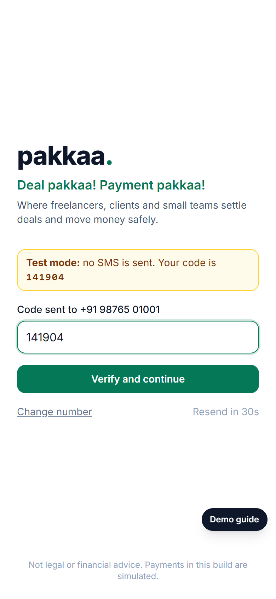 | 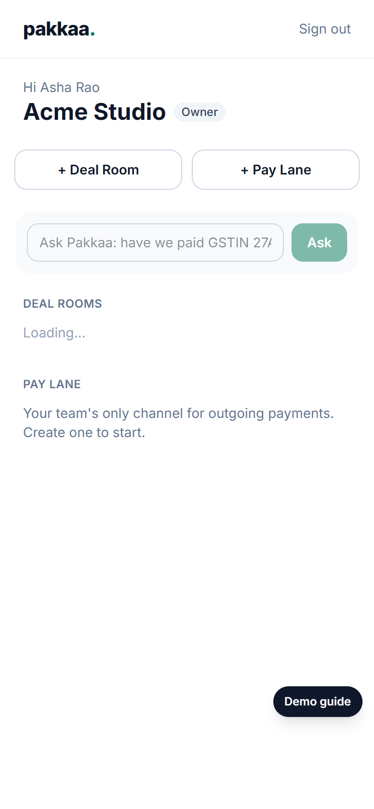 |

**Deal Room: money in**

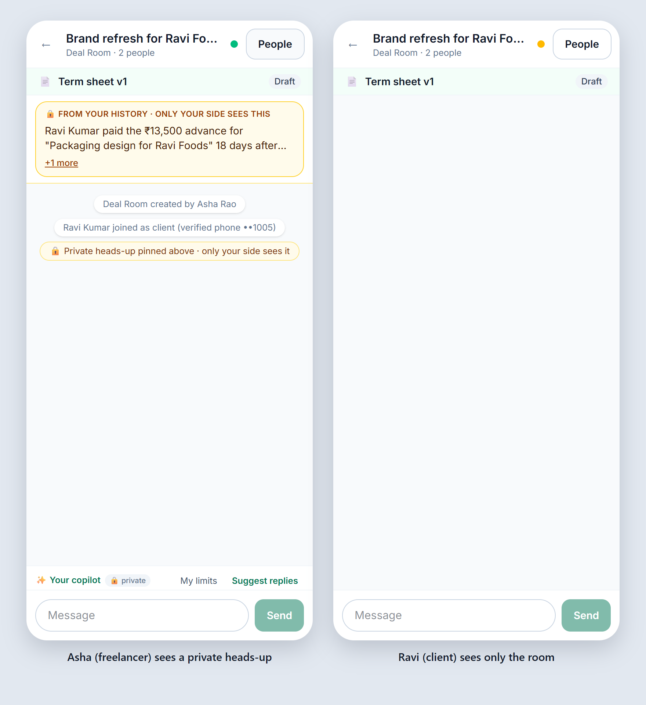<br>
*Ravi joins. Asha privately sees that he paid the last advance late; Ravi never sees it.*

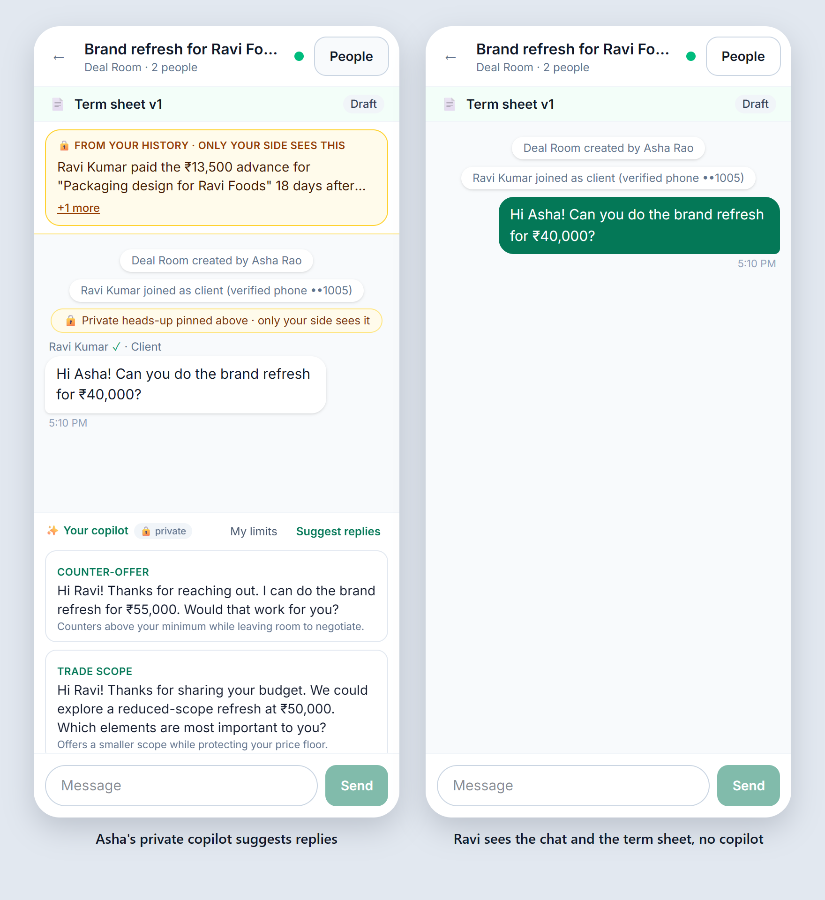<br>
*Asha's private copilot suggests replies; Ravi sees the same chat and the shared term sheet, never her copilot.*

| Pre-send check warns below the walk-away price | Scribe turns chat into terms a person confirms |
|---|---|
| 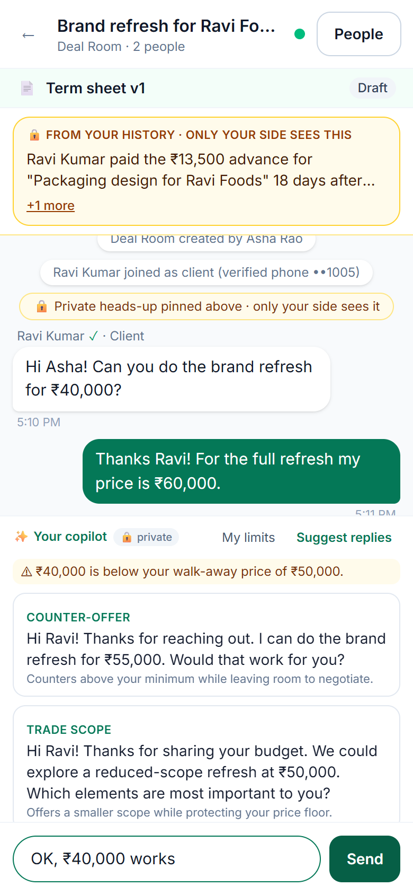 | 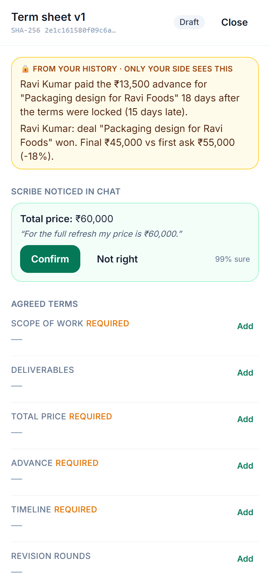 |

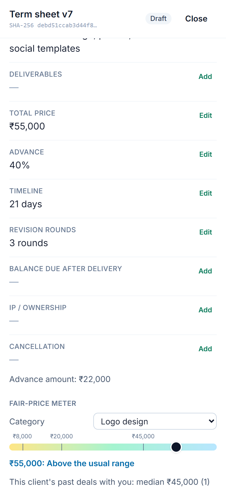<br>
*Term sheet with the fair-price meter and the checks to finish before locking.*

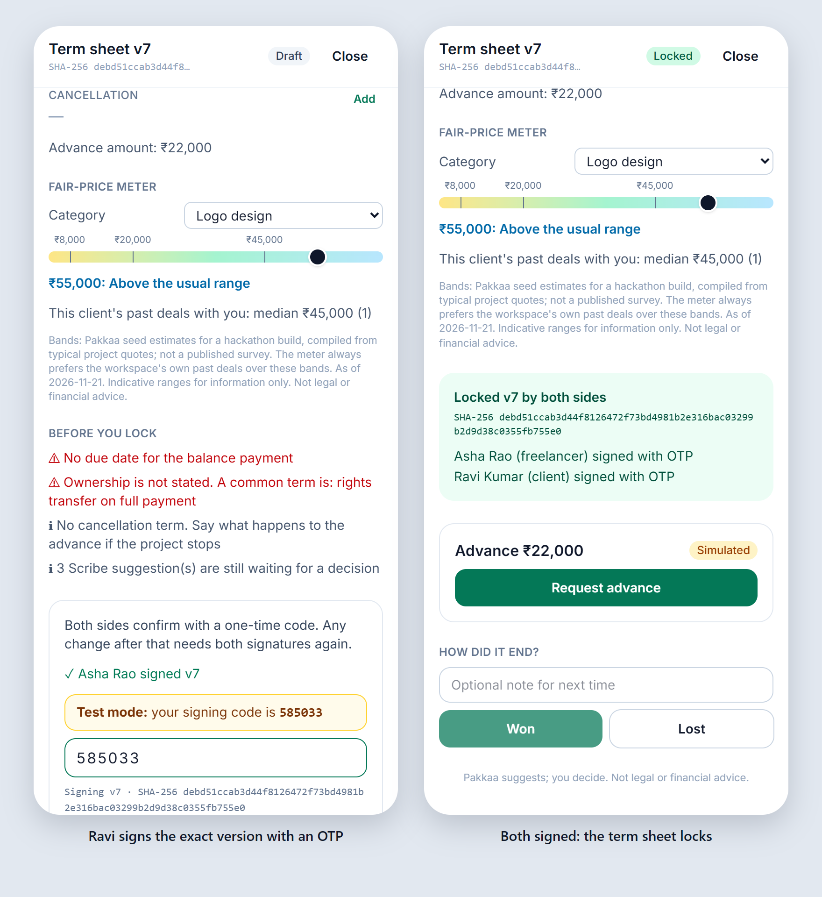<br>
*Both sides sign the exact version with an OTP; the sheet locks with its SHA-256.*

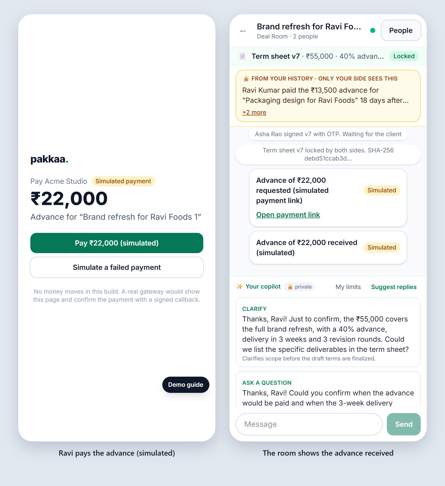<br>
*Ravi pays the advance through the (simulated) payment link; the room shows it received.*

**Pay Lane: money out**

<br>
*An impostor using the owner's name asks for money in chat: it becomes an unverified draft at risk 100.*

| Step-up check: the requester confirms the exact card with an OTP | Approver brief, risk rules and the step-up result |
|---|---|
| 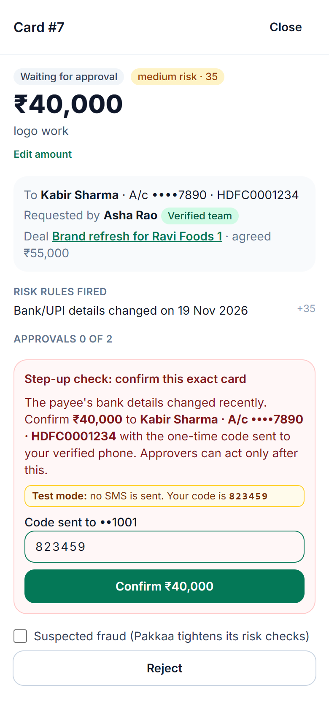 | 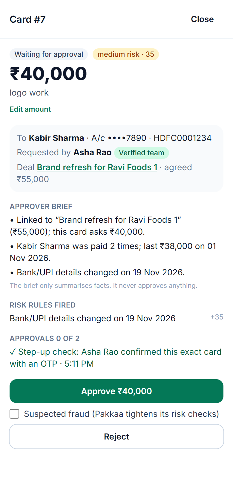 |

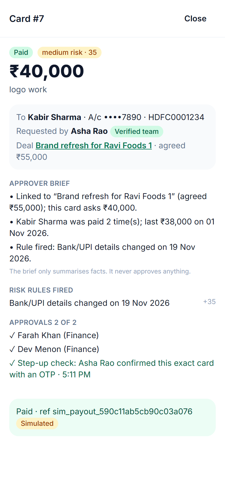<br>
*Two approvals, then a one-time (simulated) payout.*

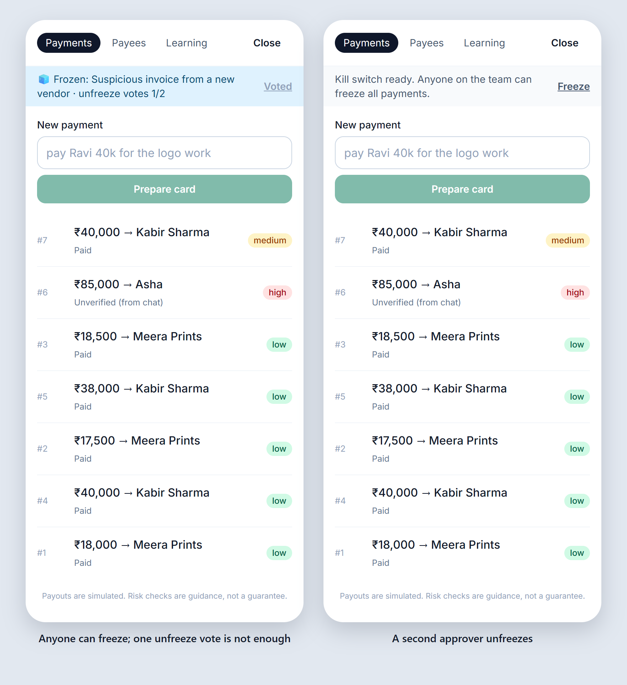<br>
*Anyone can freeze all payments; unfreezing needs two different approvers.*

**Answers and learning**

| Ask Pakkaa answers from the workspace's own records | What Pakkaa learned, and the audit chain verified |
|---|---|
| 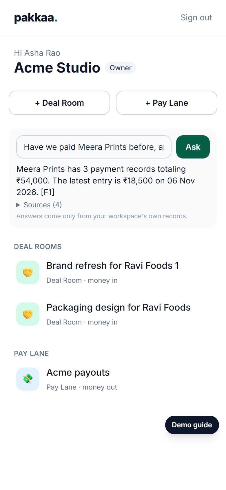 | 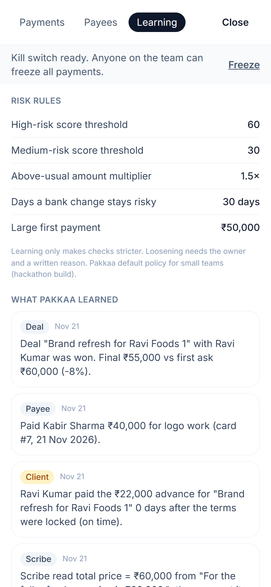 |

## All features

**Deal Room**
- Term sheet card pinned in the room; every term keeps the chat message it came from.
- Scribe reads each message and proposes terms with a quote and confidence; a person confirms each one.
- Private copilot for the freelancer's side: three streamed reply options with a tactic and a one-line why. The
  client never sees it and has no copilot; the client gets the term sheet card, OTP signing and a verified payment link.
- Pre-send check against your walk-away price and the term sheet: it warns, never blocks.
- Fair-price meter from your own past deals, then an indicative rate band labelled with its source and date.
- Clause explainer in English, Hindi or Hinglish; lock review lists missing or risky terms.
- Both sides sign the exact version with OTP; SHA-256 over the agreed values; any change needs both again.
- Advance payment link (simulated provider, idempotent status).

**Pay Lane**
- Natural-language card builder ("pay Kabir 40k for the logo work") linked to the matching deal.
- Payment instructions typed in chat become unverified drafts that can never be approved or paid.
- Risk rules in code, each with evidence: unverified requester, name clash, new or unknown payee, bank change,
  amount above the usual, unusual timing, urgency or secrecy words, off-hours, split payments, deal mismatch.
- Approvals by amount band; the requester never approves their own card; any edit resets approvals; high-risk
  approvals need a written reason.
- Approver brief in three lines (rewords code-built facts only; never approves).
- Step-up check for high-risk cards: the requester re-confirms the exact amount and payee account with an OTP on
  their verified phone; any edit invalidates it, and nobody can approve or pay until it is done.
- Two-key kill switch; payouts are idempotent and check the freeze first. Ask Pakkaa answers from workspace records.

**Memory and learning**
- Signals: suggestions sent, edited or ignored; Scribe corrections; deal outcomes (first ask vs final); days to
  pay the advance; payouts; high-risk overrides with reasons; suspected-fraud reports.
- Uses: per-person tactic ranking, corrections as few-shot examples for the Scribe, pgvector playbook recall for
  the copilot (keyword fallback when embeddings are unavailable), counterparty heads-ups for the team side only,
  payee baselines and timing in the risk engine.
- Learning only tightens risk thresholds; loosening needs the owner and a written reason. Memory is scoped per
  org, private items are visible only to their owner, and every item keeps its source interaction.

**Safety and audit**
- One append-only, hash-chained audit log per org; verify and export (JSONL or CSV) for owners and finance.
  `python scripts/verify_audit_export.py <file>` checks an export with no database or Pakkaa code.
- Phone OTP (hashed with a pepper, 5-minute expiry, attempt lockout), 15-minute access tokens, rotating refresh
  cookies with reuse detection, org isolation (other orgs get 404), rate limits on every state change.
- Bank and UPI details encrypted with AES-256-GCM (versioned keys) and masked to the last 4 everywhere.
- AI advises, code decides: no model output can lock, approve, pay or change roles; every structured output is
  validated and chat text is passed to models as untrusted data.

## Architecture

```
apps/web        React + Vite + TypeScript + Tailwind (mobile first), Nexconn Web Chat SDK
services/api    FastAPI, SQLAlchemy, Alembic, Postgres + pgvector, OpenAI (one model per lane)
scripts/        local database, secrets, demo seed, audit export verifier
vercel.json     Vercel Services: web (Vite) and api (FastAPI, Singapore region)
```

- The API is the source of truth. Every room message goes through `POST /api/rooms/{id}/messages`, is stored,
  checked by the Scribe or the money-talk detector, and delivered live through Nexconn's server API. Cards are a
  custom Nexconn message type `PK:Card` posted by the Pakkaa bot; private notices use directed messages.
- The Nexconn App Secret stays on the server. Browsers get only the App Key and a per-user token.
- Models: `gpt-6-luna` for fast checks, `gpt-6.1-terra` for live copilot replies, `gpt-6.2-sol` for extraction,
  briefs and explanations, `gpt-6.2-astra` for slow high-stakes work, `text-embedding-3-small` for memory.

See [docs/TECHNICAL.md](docs/TECHNICAL.md) for the tech stack per feature and how each part works,
[NEXCONN_NOTES.md](NEXCONN_NOTES.md) for how Nexconn is used, and [TODO.md](TODO.md) for progress.

## Run the 3-minute demo

The live site runs in demo mode with the **Acme Studio** workspace seeded. Open it on two phones (or a normal and
an incognito window), tap **Demo guide** for the script, and sign in with the demo numbers below. In demo mode the
one-time code appears on screen.

| Number | Person | Role |
|---|---|---|
| 98765 01001 | Asha Rao | Owner, freelancer (phone A) |
| 98765 01005 | Ravi Kumar | Client from Ravi Foods (phone B) |
| 98765 01002 | Farah Khan | Finance, first approver |
| 98765 01003 | Dev Menon | Finance, second approver |
| 98765 01009 | "Asha Rao" | Impostor vendor using the owner's name |

1. **Deal Room:** Asha creates a deal and invites Ravi; when he joins, only Asha sees that Ravi paid the last
   advance 15 days late. Asha's copilot suggests replies; the pre-send check warns below her walk-away;
   the Scribe fills the term sheet; both sign with OTP; Ravi pays the advance (simulated).
2. **Pay Lane:** the impostor's "urgent, confidential" transfer becomes an unverified draft at risk 100. Asha's
   card for Kabir is high risk (bank details changed), so Asha confirms it with an OTP; Farah reads the approver
   brief and approves, Dev approves, payout (simulated).
3. **Learning:** mark the deal won; Pay Lane → Learning shows what Pakkaa learned and the audit chain verifies.

To seed your own database: `.\services\api\.venv\Scripts\python scripts\seed_demo.py` (add `--reset` to rebuild
the demo workspace; seeding a non-local database requires `--allow-remote`). Set `DEMO_MODE=true` to show codes on
screen and the demo guide.

## Run it locally (Windows, PowerShell)

Prerequisites: Git, Python 3.12, Node.js 20 or newer.

1. Clone and create your env file:
   ```powershell
   git clone https://github.com/Chiru595/pakkaa
   cd pakkaa
   py -3.12 scripts\gen_secrets.py
   ```
   Then open `.env` and fill `NEXCONN_APP_KEY`, `NEXCONN_APP_SECRET` and `OPENAI_API_KEY`.

2. API dependencies:
   ```powershell
   cd services\api
   py -3.12 -m venv .venv
   .venv\Scripts\python -m pip install -r requirements.txt -r requirements-dev.txt
   cd ..\..
   ```

3. Database (Postgres 16 with pgvector). Either Docker:
   ```powershell
   docker compose up -d
   ```
   or, without Docker, an embedded Postgres that also updates `.env`:
   ```powershell
   .\services\api\.venv\Scripts\python scripts\dev_db.py
   ```

4. Migrations, demo data and API (keep this terminal open):
   ```powershell
   cd services\api
   .venv\Scripts\alembic upgrade head
   .venv\Scripts\python ..\..\scripts\seed_demo.py
   .venv\Scripts\python -m uvicorn app.main:app --port 8000 --reload --reload-dir app
   ```

5. Web app (second terminal):
   ```powershell
   cd apps\web
   npm install
   npm run dev
   ```

6. Open http://localhost:5173. In development the one-time code is shown on screen (no SMS is sent). To also see
   the **Demo guide** button, set `DEMO_MODE=true` in `.env` and restart the API.

After a restart, run `scripts\dev_db.py` again (if you use the embedded database), then steps 4 and 5.

## Tests

```powershell
cd services\api
.venv\Scripts\python -m pytest -q
.venv\Scripts\python -m ruff check app tests
cd ..\..\apps\web
npx tsc -b
```

112 API tests run against a real Postgres database (`pakkaa_test`, created by `scripts/dev_db.py` or Docker, or
set `TEST_DATABASE_URL`), with every model request mocked. They include the red-team cases: impostor payouts, chat
commands to approve, self-approval, approvals reset on edit, bank change with urgency (step-up OTP required),
copilot only for the freelancer's side, double payouts, audit tampering, cross-org access, payouts while frozen, and learning
never loosening.

## Limitations

- Payments are simulated (no payment provider in this build); every payment is labelled "Simulated".
- Demo mode shows login codes on screen; production use needs an SMS provider with DLT-registered templates.
- Rate bands are indicative seed estimates with source and date, not a published survey.

## Sources

1. Razorpay, *Fix My Itch*, problem list and itch scores (accessed 21 Nov 2026). https://razorpay.com/m/fix-my-itch/#all-problems
2. The Shorty Awards (18th), *Razorpay Fix My Itch* (method: AI-gathered and surveyed inputs, scored on severity,
   frequency and potential market size). https://shortyawards.com/18th/razorpay-fix-my-itch
3. Ministry of MSME, *MSME Samadhaan* dashboard (accessed 21 Nov 2026). https://samadhaan.msme.gov.in/MyMsme/MSEFC/MSEFC_Welcome.aspx
4. Free Press Journal, *Quantum of delayed payments to MSMEs steadily declines to ₹7.34 lakh crore* (26 Nov 2025).
   https://www.freepressjournal.in/business/quantum-of-delayed-payments-to-msmes-steadily-declines-to-734-lakh-crore-roars-positive-impact-of-policy-measures
5. Remote, *Reversing late payment culture* (Contractor Management Report 2025, 19 Feb 2025). https://remote.com/blog/reversing-late-payment-culture
6. ContentGrip on the Smallpdf Freelancer Freedom Index 2026 (1 Jul 2026). https://www.contentgrip.com/freelancer-admin-ai-gap/
7. Inc42 on the PayPal India Freelancer Report (15 Jan 2018). https://inc42.com/features/paypal-freelancers-digital-payments
8. NITI Aayog, *India's Booming Gig and Platform Economy* (27 Jun 2022). https://www.niti.gov.in/sites/default/files/2022-06/Policy_Brief_India's_Booming_Gig_and_Platform_Economy_27062022.pdf
9. Business Today, *63 transactions, ₹10 crore gone: how a fake WhatsApp message fooled a company* (18 Jun 2026).
   https://businesstoday.in/latest/trends/story/63-transactions-rs10-crore-gone-how-a-fake-whatsapp-message-fooled-a-company-537698-2026-06-18
10. Free Press Journal, *Firm duped of ₹1.98 crore in WhatsApp director impersonation scam* (6 Aug 2026).
    https://www.freepressjournal.in/mumbai/mumbai-cyber-fraud-firm-duped-of-198-crore-in-whatsapp-director-impersonation-scam-fir-registered
11. Free Press Journal, *Accountant duped of ₹1.95 crore by fraudster posing as director* (17 Jan 2025).
    https://www.freepressjournal.in/mumbai/maharashtra-54-year-old-accountant-duped-of-195-crore-by-fraudster-posing-as-director-in-fake-whatsapp-call-scam-case-registered
12. Free Press Journal, *Accountant duped of ₹1.9 crore in WhatsApp DP fraud* (21 Mar 2025).
    https://www.freepressjournal.in/mumbai/maharashtra-news-72-year-old-accountant-duped-of-19-crore-in-whatsapp-dp-fraud-after-scammer-poses-as-company-director
13. YourStory on the Ministry of Home Affairs reply in the Lok Sabha (22 Jul 2025). https://yourstory.com/2025/07/citizens-lost-over-rs-22845-cr-to-cyber-criminals-in-2024
14. FBI Internet Crime Complaint Center, *2025 Internet Crime Report* (Apr 2026). https://www.ic3.gov/AnnualReport/Reports/2025_IC3Report.pdf
15. AFP, *2026 Payments Fraud and Control Survey* (14 Apr 2026). https://www.financialprofessionals.org/about/learn-more/press-releases/Details/over-75-percent-of-us-firms-experienced-payments-fraud-in-2025-while-ai-adoption-for-fraud-mitigation-lags
16. Razorpay, *RazorpayX Payouts* (approval workflows and account verification). https://razorpay.com/x/payouts/

## Prior work

See [PRIOR_WORK.md](PRIOR_WORK.md).
