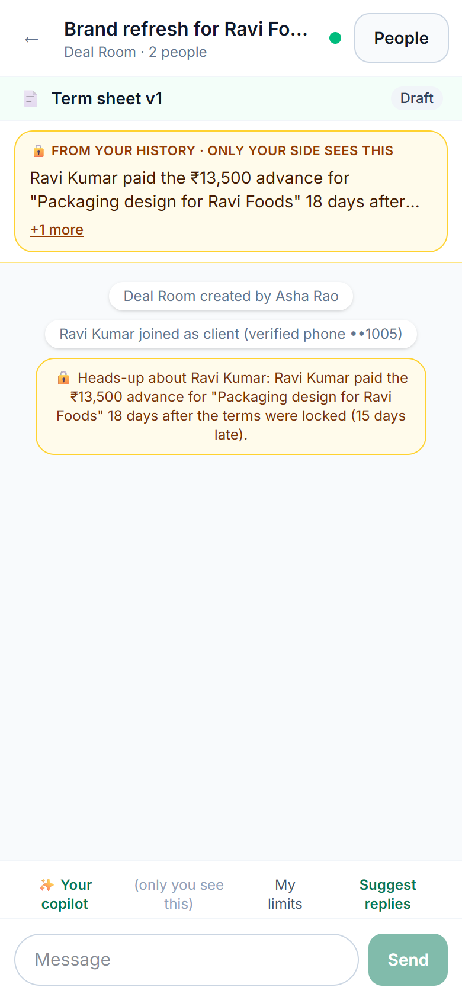
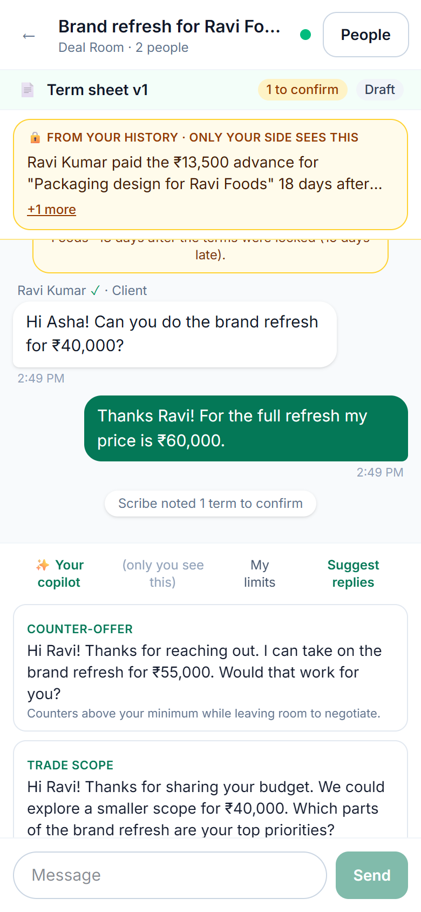
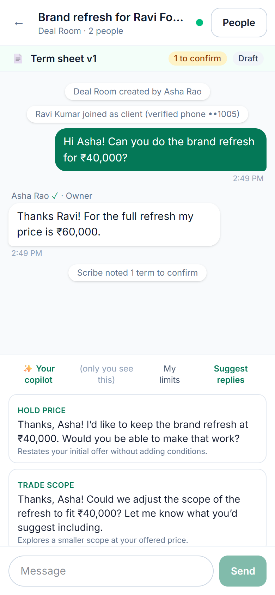
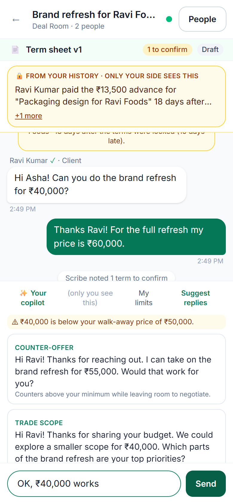
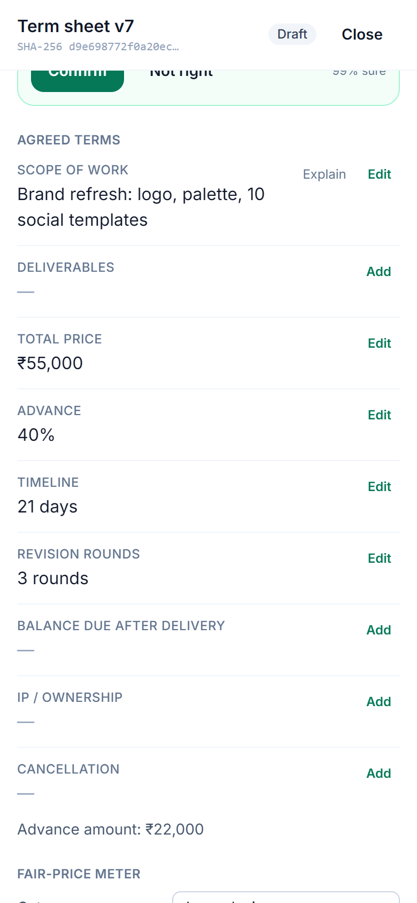
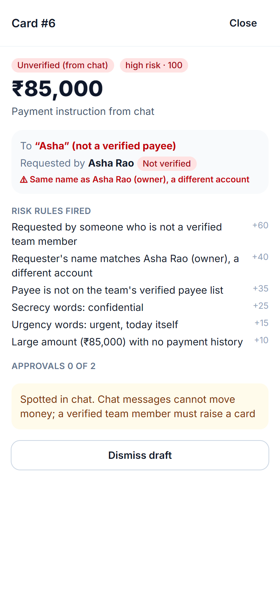
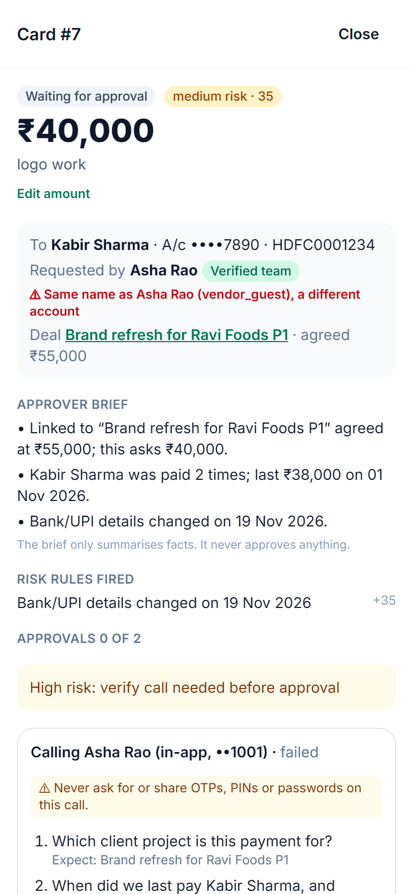
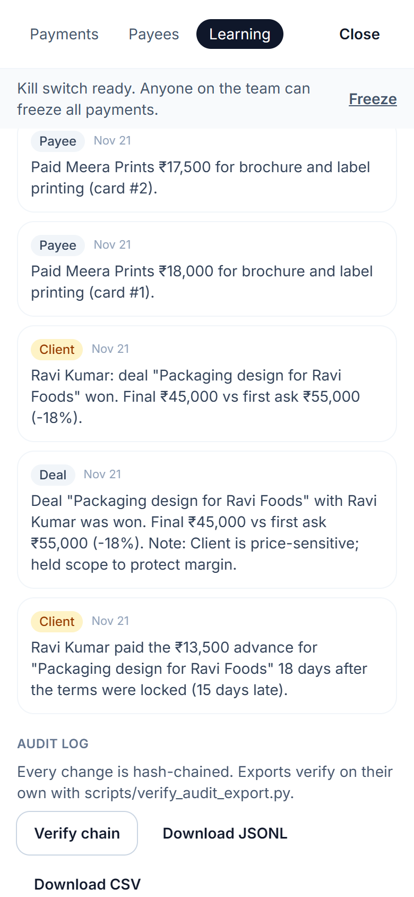

# Pakkaa

**Deal pakkaa! Payment pakkaa!**

Pakkaa is the money layer for business conversations, for Indian freelancers, agencies and small suppliers.

- **Deal Room (money in):** freelancer and client negotiate in one room, each with a private AI copilot. Agreed
  terms fill a live term sheet, both sides lock it with OTP, and the advance is requested through a payment link.
- **Pay Lane (money out):** the team's only valid channel for outgoing payments. Payment cards come only from
  verified people, are risk-checked, verified by an in-app call when risky, approved by two people, then paid.
- **It learns:** late payers, deal outcomes, Scribe corrections and payout history shape the next negotiation and
  the next risk check. Learning only ever makes checks stricter.

Everyday chat stays on WhatsApp or Slack. Pakkaa is where money is decided.

Live: **https://pakkaa-atozz.vercel.app** (demo mode: login codes are shown on screen, payments are simulated).
Built on [Nexconn](https://www.nexconn.ai) Chat and Call. Nothing here is legal or financial advice.

| Deal Room: private heads-up | Copilot (freelancer) | Copilot (client) | Pre-send check |
|---|---|---|---|
|  |  |  |  |
| **Term sheet and fair price** | **Impostor blocked** | **Verify call** | **What Pakkaa learned** |
|  |  |  |  |

## Features

**Deal Room**
- Term sheet card pinned in the room; every term keeps the chat message it came from.
- Scribe reads each message and proposes terms with a quote and confidence; a person confirms each one.
- Private copilot per person: three streamed reply options with a tactic and a one-line why. It sees only its
  owner's side (the other side's limits, notes and suggestions never enter its context).
- Pre-send check against your walk-away price and the term sheet: it warns, never blocks.
- Fair-price meter from your own past deals, then an indicative rate band labelled with its source and date.
- Clause explainer in English, Hindi or Hinglish; lock review lists missing or risky terms.
- Both sides sign the exact version with OTP; SHA-256 over the agreed values; any change needs both again.
- Advance payment link (simulated provider, idempotent status).

**Pay Lane**
- Natural-language card builder ("pay Kabir 40k for the logo work") linked to the matching deal.
- Payment instructions typed in chat become unverified drafts that can never be approved or paid.
- Risk rules in code, each with evidence: unverified requester, name clash, new or unknown payee, bank change,
  amount above the usual, unusual timing, urgency or secrecy words, off-hours, split payments, deal mismatch.
- Approvals by amount band; the requester never approves their own card; any edit resets approvals; high-risk
  approvals need a written reason.
- Approver brief in three lines (rewords code-built facts only; never approves).
- Verify call over the Nexconn Call SDK to the requester's verified in-app account, with challenge questions from
  the org's own records. Never asks for OTPs, PINs or passwords.
- Two-key kill switch; payouts are idempotent and check the freeze first. Ask Pakkaa answers from workspace records.

**Memory and learning**
- Signals: suggestions sent, edited or ignored; Scribe corrections; deal outcomes (first ask vs final); days to
  pay the advance; payouts; high-risk overrides with reasons; suspected-fraud reports.
- Uses: per-person tactic ranking, corrections as few-shot examples for the Scribe, pgvector playbook recall for
  the copilot (keyword fallback when embeddings are unavailable), counterparty heads-ups for the team side only,
  payee baselines and timing in the risk engine.
- Learning only tightens risk thresholds; loosening needs the owner and a written reason. Memory is scoped per
  org, private items are visible only to their owner, and every item keeps its source interaction.

**Safety and audit**
- One append-only, hash-chained audit log per org; verify and export (JSONL or CSV) for owners and finance.
  `python scripts/verify_audit_export.py <file>` checks an export with no database or Pakkaa code.
- Phone OTP (hashed with a pepper, 5-minute expiry, attempt lockout), 15-minute access tokens, rotating refresh
  cookies with reuse detection, org isolation (other orgs get 404), rate limits on every state change.
- Bank and UPI details encrypted with AES-256-GCM (versioned keys) and masked to the last 4 everywhere.
- AI advises, code decides: no model output can lock, approve, pay or change roles; every structured output is
  validated and chat text is passed to models as untrusted data.

## Architecture

```
apps/web        React + Vite + TypeScript + Tailwind (mobile first), Nexconn Web Chat and Call SDKs
services/api    FastAPI, SQLAlchemy, Alembic, Postgres + pgvector, OpenAI (one model per lane)
scripts/        local database, secrets, demo seed, audit export verifier
vercel.json     Vercel Services: web (Vite) and api (FastAPI, Singapore region)
```

- The API is the source of truth. Every room message goes through `POST /api/rooms/{id}/messages`, is stored,
  checked by the Scribe or the money-talk detector, and delivered live through Nexconn's server API. Cards are a
  custom Nexconn message type `PK:Card` posted by the Pakkaa bot; private notices use directed messages.
- The Nexconn App Secret stays on the server. Browsers get only the App Key and a per-user token.
- Models: `gpt-6-luna` for fast checks, `gpt-6.1-terra` for live copilot replies, `gpt-6.2-sol` for extraction,
  briefs and explanations, `gpt-6.2-astra` for slow high-stakes work, `text-embedding-3-small` for memory.

See [NEXCONN_NOTES.md](NEXCONN_NOTES.md) for how Nexconn is used and [TODO.md](TODO.md) for progress.

## Run the 3-minute demo

The live site runs in demo mode with the **Acme Studio** workspace seeded. Open it on two phones (or a normal and
an incognito window), tap **Demo guide** for the script, and sign in with the demo numbers below. In demo mode the
one-time code appears on screen.

| Number | Person | Role |
|---|---|---|
| 98765 01001 | Asha Rao | Owner, freelancer (phone A) |
| 98765 01005 | Ravi Kumar | Client from Ravi Foods (phone B) |
| 98765 01002 | Farah Khan | Finance, first approver |
| 98765 01003 | Dev Menon | Finance, second approver |
| 98765 01009 | "Asha Rao" | Impostor vendor using the owner's name |

1. **Deal Room:** Asha creates a deal and invites Ravi; when he joins, only Asha sees that Ravi paid the last
   advance 15 days late. Both copilots suggest different replies; the pre-send check warns below the walk-away;
   the Scribe fills the term sheet; both sign with OTP; Ravi pays the advance (simulated).
2. **Pay Lane:** the impostor's "urgent, confidential" transfer becomes an unverified draft at risk 100. Asha's
   card for Kabir shows the linked deal and the approver brief; Farah runs the verify call and approves, Dev
   approves, payout (simulated).
3. **Learning:** mark the deal won; Pay Lane → Learning shows what Pakkaa learned and the audit chain verifies.

To seed your own database: `.\services\api\.venv\Scripts\python scripts\seed_demo.py` (add `--reset` to rebuild
the demo workspace; seeding a non-local database requires `--allow-remote`). Set `DEMO_MODE=true` to show codes on
screen and the demo guide.

## Run it locally (Windows, PowerShell)

Prerequisites: Git, Python 3.12, Node.js 20 or newer.

1. Clone and create your env file:
   ```powershell
   git clone https://github.com/Chiru595/pakkaa
   cd pakkaa
   py -3.12 scripts\gen_secrets.py
   ```
   Then open `.env` and fill `NEXCONN_APP_KEY`, `NEXCONN_APP_SECRET` and `OPENAI_API_KEY`.

2. API dependencies:
   ```powershell
   cd services\api
   py -3.12 -m venv .venv
   .venv\Scripts\python -m pip install -r requirements.txt -r requirements-dev.txt
   cd ..\..
   ```

3. Database (Postgres 16 with pgvector). Either Docker:
   ```powershell
   docker compose up -d
   ```
   or, without Docker, an embedded Postgres that also updates `.env`:
   ```powershell
   .\services\api\.venv\Scripts\python scripts\dev_db.py
   ```

4. Migrations, demo data and API (keep this terminal open):
   ```powershell
   cd services\api
   .venv\Scripts\alembic upgrade head
   .venv\Scripts\python ..\..\scripts\seed_demo.py
   .venv\Scripts\python -m uvicorn app.main:app --port 8000 --reload --reload-dir app
   ```

5. Web app (second terminal):
   ```powershell
   cd apps\web
   npm install
   npm run dev
   ```

6. Open http://localhost:5173. In development the one-time code is shown on screen (no SMS is sent).

After a restart, run `scripts\dev_db.py` again (if you use the embedded database), then steps 4 and 5.

## Tests

```powershell
cd services\api
.venv\Scripts\python -m pytest -q
.venv\Scripts\python -m ruff check app tests
cd ..\..\apps\web
npx tsc -b
```

107 API tests run against a real Postgres database (`pakkaa_test`, created by `scripts/dev_db.py` or Docker, or
set `TEST_DATABASE_URL`), with every model call mocked. They include the red-team cases: impostor payouts, chat
commands to approve, self-approval, approvals reset on edit, bank change with urgency, copilot privacy between
sides, double payouts, audit tampering, cross-org access, payouts while frozen, and learning never loosening.

## Limitations

- Payments are simulated (no payment provider in this build); every payment is labelled "Simulated".
- Demo mode shows login codes on screen; production use needs an SMS provider with DLT-registered templates.
- The in-app verify call needs audio/video calling enabled in the Nexconn console; until then the approver records
  the outcome manually and the error is shown.
- Rate bands are indicative seed estimates with source and date, not a published survey.

## Prior work

See [PRIOR_WORK.md](PRIOR_WORK.md).
